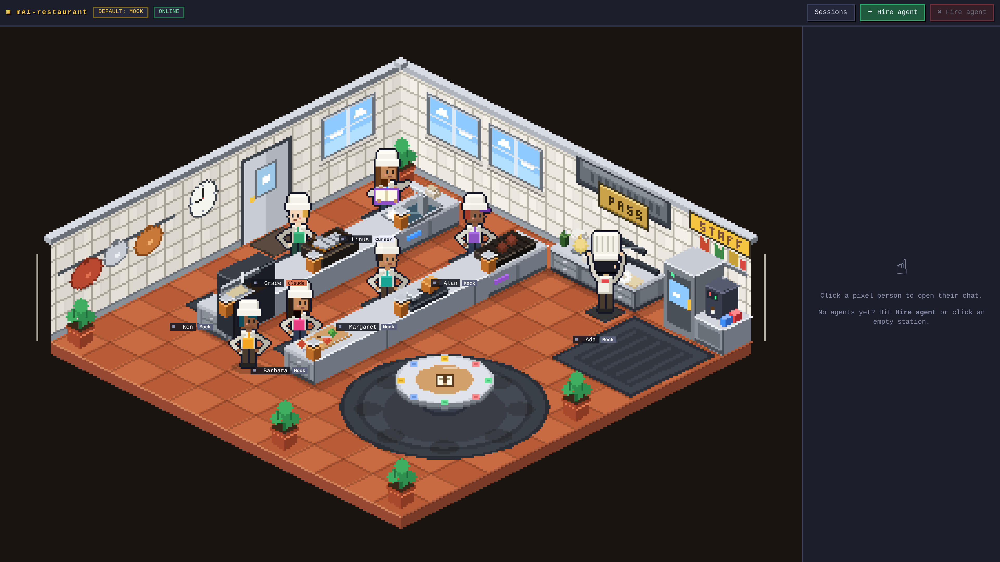

# mAI-restaurant

A pixel kitchen on your own machine that wraps Claude Code and the Cursor CLI. Each agent is a cook at a station: you click them, type, and watch them work.



## Setup

You need Node 18 or newer, plus Claude Code (`claude`) and/or the Cursor CLI (`cursor-agent` or `agent`), installed and logged in.

```bash
git clone https://github.com/AndriSatria/mai-restaurant
cd mai-restaurant
npm install
npm run start:claude   # Claude Code as the default agent type
# or
npm start              # picks claude, then cursor, then mock, whichever it finds
```

Open http://127.0.0.1:3000 and click **＋ Hire agent**. Pick the agent type and the project folder it should work in.

No CLI installed? `npm run start:mock` runs simulated agents with fake data so you can try the kitchen first.

## What it does with your Claude / Cursor actions

Every message you send runs the real CLI in print mode (`claude -p` or `agent -p`) in that agent's folder, and the kitchen draws what the CLI reports.

| You do / the CLI does | You see in the kitchen |
| --- | --- |
| Send a prompt | The cook starts thinking. The chat shows `> your prompt`, like the terminal. |
| Read, edit, write, run Bash | The cook chops or stirs, steam rises from the stove, and the tool name floats over their head. The chat gets `● Read(file)` lines with results, edit diffs and todo lists. |
| Reply | Markdown in the chat and a speech bubble over the cook. A `Done in … · N turns · $…` line closes the run. |
| Subagents and background agents (e.g. `/code-review`) | Idle colleagues become kitchen hands. The head chef hands each one a ticket, they walk to the station their tools need (pantry for reads, stove for Bash), carry the dish back to the pass, then go home. The lead waits until all of them report. |
| Plan mode | The team walks to the pass. When the plan is ready they cheer and go back. |
| Slash commands | Type `/` to pick from your own commands and skills (`~/.claude/commands`, skills, plugins, project folders). The text goes to the CLI unchanged. |
| A Claude tool needs your OK | The cook walks to the pass and holds the plate up. **Yes, chef** or **No, chef** at the top of the side panel answers the CLI. |
| Permission modes | Shift+Tab in the message box cycles modes, like the CLI: default, accept edits and plan for Claude; default, plan and ask for Cursor. |
| Resume a session | **Sessions** lists your local Claude Code sessions and Cursor CLI chats by project. **Resume in kitchen** seats one at a station with its history. |
| Stop | Esc in the message box or **■ Stop** ends the run. |
| Nothing to do | Idle cooks stretch, read, get a coffee, chat by the walk-in fridge or take a break at the staff table. |
| The plan's usage limit runs out | Every cook on that CLI rests at the staff table, and a board over it reads **KITCHEN CLOSED, Back at 18:30**, the reset time from the CLI's limit message. The kitchen opens again at that time, or as soon as a run goes through. |

The first person you hire stands at the pass as head chef (tall toque). Up to 7 people fit in the kitchen: 6 cook stations and the pass.

### Not supported

- Terminal sessions are not live-synced. Resume copies a session's history when you click it. Later changes in your terminal do not show up.
- Cursor editor chats can't be resumed, only Cursor CLI chats.
- Interactive CLI built-ins (`/clear`, `/model`, `/resume`, login prompts) don't work, because every run is headless.
- Approvals at the pass work for Claude Code only, through the Agent SDK's stdio permission prompt. Cursor's print mode has no way to ask, so a Cursor run in default mode only proposes edits. Its `agent acp` server can ask, but this app doesn't use it yet.
- The closed board reads the limit message text ("You've hit your session limit · resets 6pm", Cursor's "monthly cycle ends on …"). If a CLI changes that wording, the kitchen stays open.
- The Claude and Cursor adapters are tested against fake CLIs that follow the documented output, not against a logged-in CLI.

## Settings

| Variable | Default | What it does |
| --- | --- | --- |
| `PORT` | `3000` | Port for the page |
| `HOST` | `127.0.0.1` | Bind address. Keep it on loopback: there is no login. |
| `HARNESS_MODE` | auto | Default agent type: `claude`, `cursor` or `mock` |
| `HARNESS_DEFAULT_CWD` | current folder | Folder suggested in the Hire dialog |
| `HARNESS_CLAUDE_ARGS` | none | Extra Claude args, e.g. `--model sonnet` or `--allowedTools Bash,Read,Edit` |
| `HARNESS_CURSOR_ARGS` | none | Extra Cursor args, e.g. `--model …` |
| `HARNESS_ALLOW_BYPASS` | off | `1` adds `bypassPermissions` (Claude) and `--force` (Cursor) to the Shift+Tab cycle |
| `HARNESS_PARTIAL` | off | `1` streams replies token by token |
| `HARNESS_DEBUG_EVENTS` | off | `1` saves every raw CLI event to `data/debug/` |

Agents, chats and session ids are saved in `data/agents.json`.

## Privacy

The server listens on 127.0.0.1 only and makes no outbound calls of its own; only the CLIs you run talk to their services. It reads `~/.claude` and `~/.cursor` but never writes there. Debug capture files contain your prompts, code and tool output, so delete them when you are done.

## More

[docs/ROADMAP.md](docs/ROADMAP.md) lists what is built and what is next. [docs/DETAILS.md](docs/DETAILS.md) covers the renderer, the adapter internals and event shapes, the WebSocket protocol, tests and screenshot scripts.
